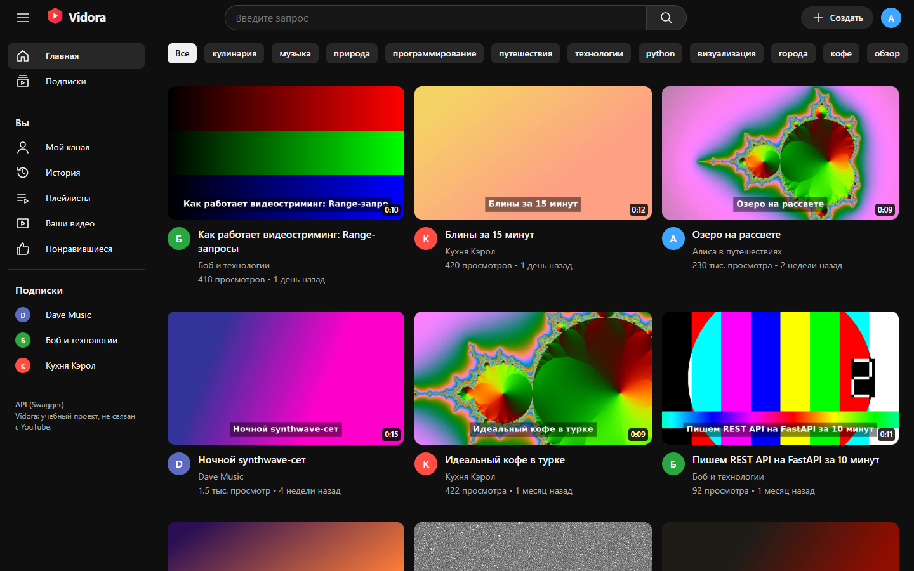
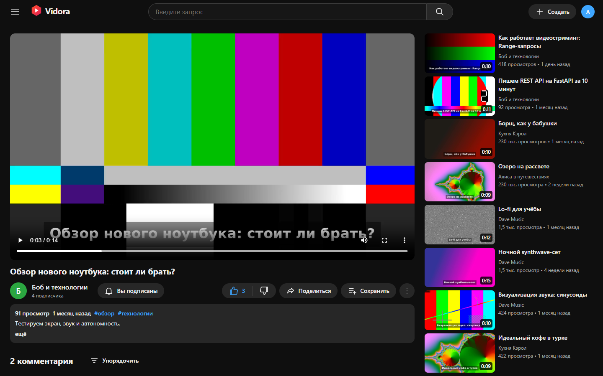
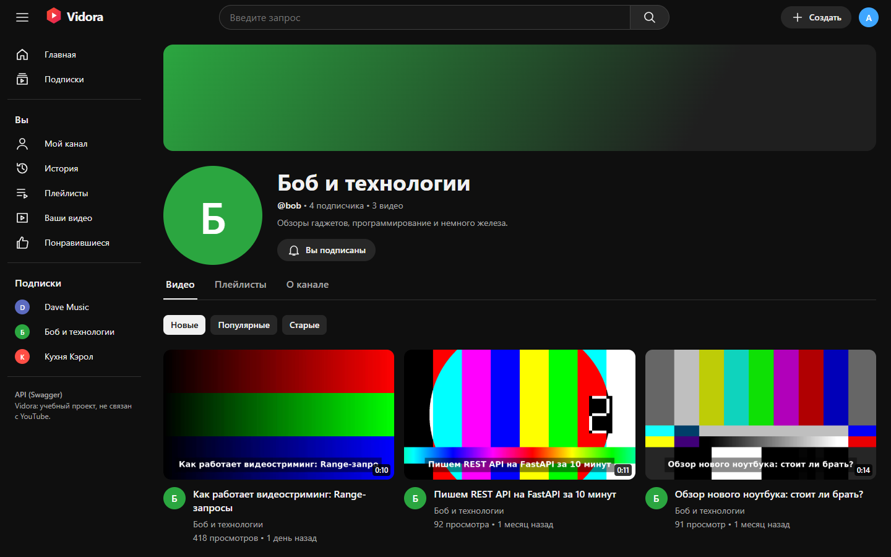
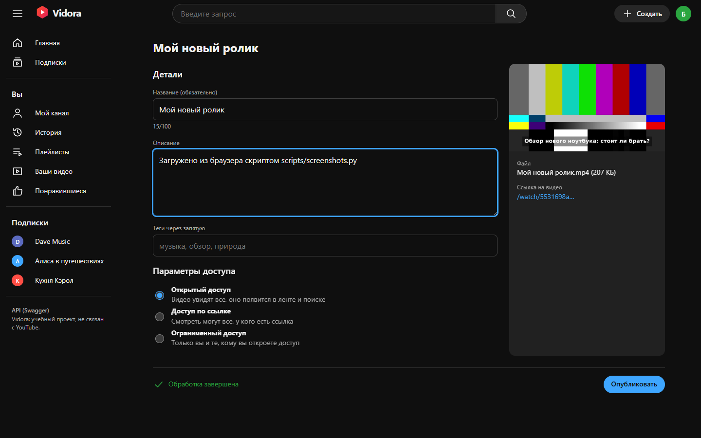
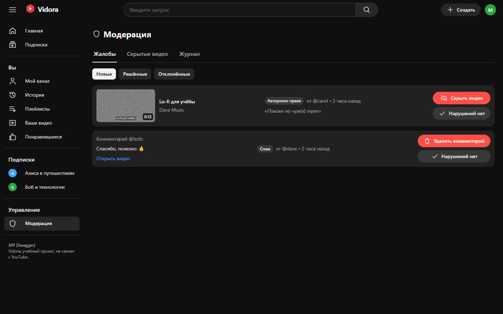
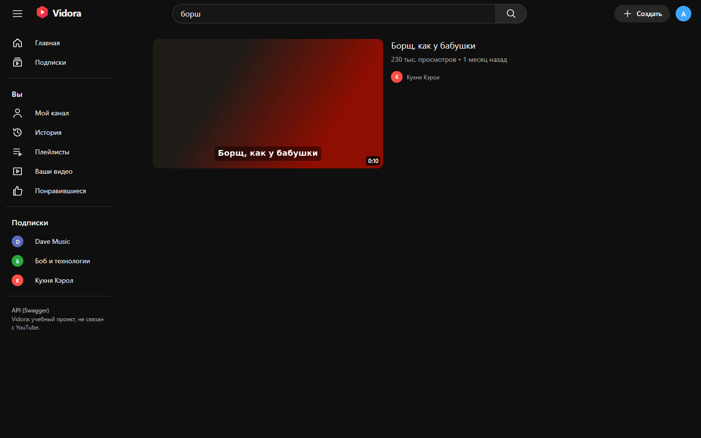
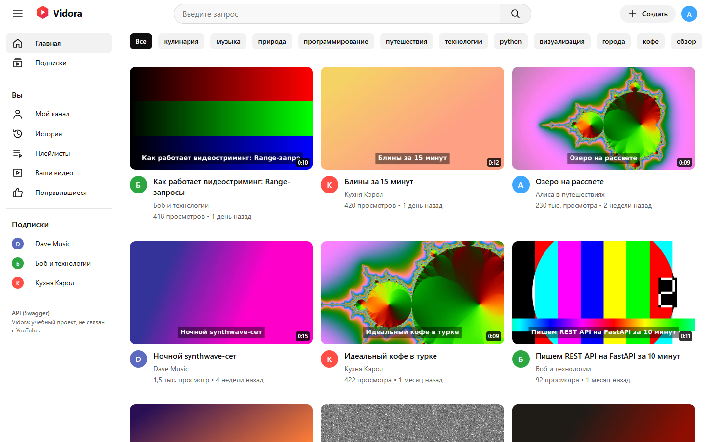

# Vidora

Видеоплатформа в духе YouTube: загрузка, обработка и раздача видео, каналы, подписки,
плейлисты, лайки, комментарии с ответами, поиск, приватные видео с выдачей доступа,
модерация и роли. Тестовое задание. Весь код написан ИИ (Claude Code), процесс описан в
[`docs/ai-workflow.md`](docs/ai-workflow.md).

Свой бренд (название, логотип, иконки): Vidora не использует логотип и брендинг YouTube.



| Просмотр | Канал |
|---|---|
|  |  |
| **Загрузка** | **Модерация** |
|  |  |
| **Поиск с опечаткой («борш»)** | **Светлая тема** |
|  |  |

Скриншоты сняты скриптом `scripts/screenshots.py` (Playwright) с живого стека с демо-данными.

## Запуск одной командой

На чистой Ubuntu 22.04 / 24.04 (2 ГБ RAM, 5 ГБ диска, свободные порты 80 и 443):

```bash
git clone https://github.com/Yarik002/vidora.git && cd vidora && ./deploy.sh --demo
```

Скрипт сам ставит Docker (официальный apt-репозиторий), генерирует секреты в `.env`,
собирает образы, поднимает Caddy, API, воркер, PostgreSQL, Redis и MinIO, применяет миграции,
создаёт админа, с флагом `--demo` заливает демо-данные (5 пользователей, 14 видео,
сгенерированных ffmpeg, комментарии, лайки, подписки, плейлисты, жалобы). В конце печатает
адрес и логины. Повторный запуск безопасен: секреты и данные сохраняются.

Первый запуск занимает 5-15 минут (сборка образов и транскод 14 демо-видео).

- Откройте `https://<IP сервера>` или `https://localhost`. Сертификат самоподписанный
  (внутренний CA Caddy), браузер один раз попросит подтвердить.
- С доменом и настоящим сертификатом Let's Encrypt:
  `./deploy.sh --demo --domain video.example.com --email you@example.com`.
- Swagger: `https://<адрес>/docs` (кнопка *Authorize*: логин и пароль).

### Тестовые логины
`deploy.sh` печатает их в конце. Если вывод потерялся:
```bash
grep -E '^(ADMIN_USERNAME|ADMIN_PASSWORD|DEMO_PASSWORD)=' .env
```
| Логин | Роль | Пароль |
|---|---|---|
| `admin` | администратор | `ADMIN_PASSWORD` |
| `moderator` | модератор | `DEMO_PASSWORD` |
| `alice`, `bob`, `carol`, `dave` | пользователи с каналами и видео | `DEMO_PASSWORD` |

Пароли случайные для каждой установки. Войти можно по логину или email.

### Проверить сценарий «регистрация → загрузка → просмотр → лайк и комментарий»
Руками: «Войти» → «Создать аккаунт» → «Создать» → выбрать любое видео → дождаться
«Обработка завершена» → «Опубликовать» → «Смотреть» → лайк → комментарий.

Автоматически (тот же путь через HTTPS, как браузер):
```bash
python3 scripts/e2e.py
```
Ещё стоит проверить: войти как `bob` и открыть приватное видео `alice` «Черновик: монтаж
поездки» (bob получил доступ), а затем как `carol` (доступа нет, видео «не существует»).
Войти как `moderator` → «Модерация» → скрыть видео по жалобе → оно пропадает из ленты, поиска
и по прямой ссылке.

## Что есть

| Экран | Что работает |
|---|---|
| Главная | лента с превью, чипы тегов, бесконечная прокрутка, скелетоны, тёмная и светлая тема |
| Просмотр | плеер с перемоткой (Range) и выбором качества 720p/360p, лайк/дизлайк, подписка, «Поделиться», «Сохранить в плейлист», жалоба, описание с тегами, комментарии с ответами, лайки комментариев, сортировка, рекомендации справа |
| Канал | баннер, аватар, подписчики, вкладки «Видео / Плейлисты / О канале», сортировка, настройки канала |
| Поиск | полнотекстовый по названию и описанию (русская морфология) + опечатки (trigram), каналы в выдаче |
| Загрузка | drag & drop, загрузка частями прямо в хранилище с реальным прогрессом и скоростью, метаданные пока идёт загрузка, статус обработки, черновик до публикации |
| Вход и регистрация | валидация, понятные ошибки, возврат на исходную страницу |
| Модерация | очередь жалоб на видео и комментарии, скрытие и восстановление, отклонение, журнал действий, управление ролями и блокировкой (админ) |
| Ещё | подписки, история, понравившиеся, плейлисты, студия «Мои видео» (доступ, редактирование, удаление, выдача доступа к приватным) |

Роли: пользователь, модератор, администратор. Приватное видео видят только владелец, staff и
пользователи из списка доступа: ни через API, ни по прямой ссылке на файл, ни в ленте, поиске,
плейлистах, истории.

## Как устроено

- **Backend:** Python 3.12, FastAPI (роутеры → сервисы → репозитории), SQLAlchemy 2 async,
  Alembic, PostgreSQL 16 (22 таблицы, FTS + pg_trgm), Redis, arq-воркер с ffmpeg.
- **Хранилище:** MinIO (S3), приватные бакеты. Браузер грузит части напрямую по presigned-ссылкам,
  смотрит по короткоживущей подписанной ссылке после проверки прав в API.
- **Frontend:** React + Vite + TypeScript, своя дизайн-система, собирается в Docker.
- **Edge:** Caddy (TLS, CSP и заголовки, единственный открытый сервис).

Подробно:
[архитектура и ADR](docs/architecture.md) ·
[база данных и ER-диаграмма](docs/database.md) ·
[безопасность и модель угроз](docs/security.md) ·
[дизайн-система](docs/design-system.md) ·
[работа с ИИ](docs/ai-workflow.md) ·
[реальные проблемы по ходу](docs/NOTES.md)

## Разработка

Нужен только Docker (Node и ffmpeg на хосте не нужны).

```bash
bash scripts/gen_env.sh                                            # секреты
docker compose -f compose.yml -f compose.dev.yml up -d --build     # + HTTP-превью на http://localhost:8080
docker compose -f compose.yml -f compose.test.yml run --rm tests   # pytest на реальных сервисах
bash scripts/dev_lint.sh --fix                                     # ruff format + check
bash scripts/dev_web.sh typecheck                                  # tsc
python3 scripts/e2e.py                                             # сквозной сценарий
python scripts/screenshots.py                                      # скриншоты + проверка экранов в Chromium
```

```
backend/      FastAPI-приложение, воркер, миграции, тесты
frontend/     React SPA
deploy/       Caddyfile, Dockerfile фронта+Caddy, инициализация MinIO
scripts/      gen_env, rotate_secret, e2e, dev-хелперы
docs/         документация
.claude/      агенты, команды и настройки Claude Code; CLAUDE.md в корне
deploy.sh     развёртывание одной командой
```

## Что и как проверено (честно)

- **53 автотеста** (`backend/tests`) на реальных Postgres, Redis, MinIO и ffmpeg: проходят.
- **E2E** `scripts/e2e.py` через Caddy по HTTPS: проходит локально (Windows + Docker Desktop).
- **`deploy.sh --demo`** проверен в чистом privileged-контейнере `ubuntu:24.04` с Docker-in-Docker
  (`git clone` → `./deploy.sh --demo` → e2e → повторный деплой). Это контейнер, а не виртуальная
  машина: systemd там нет, скрипт запускает dockerd напрямую.
- **CI** (`.github/workflows/ci.yml`): линтеры, тесты и job, который запускает `deploy.sh --demo`
  и e2e на свежих раннерах GitHub `ubuntu-22.04` и `ubuntu-24.04`, затем повторный деплой
  (идемпотентность) и проверку, что наружу открыт только Caddy.
- На настоящей чистой ВМ развёртывание не проверялось: её не было.

## Чего нет (сознательно урезано)

- HLS/DASH с адаптивным битрейтом: вместо него два MP4-качества с ручным переключением.
- Уведомления, Shorts, трансляции, загрузка аватаров и баннеров (аватар = буква + цвет),
  субтитры, рекомендации на основе поведения (сейчас: общие теги и тот же канал, затем популярное).
- Квоты хранилища в байтах на пользователя (есть лимит размера файла и числа загрузок).
- Автоматические бэкапы (описано, как делать, в `docs/architecture.md`).
- Swagger UI грузит скрипты с CDN (требование «Swagger на /docs»), см. `docs/security.md`.
