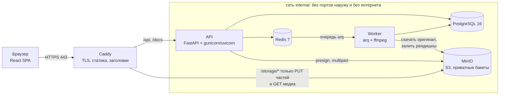
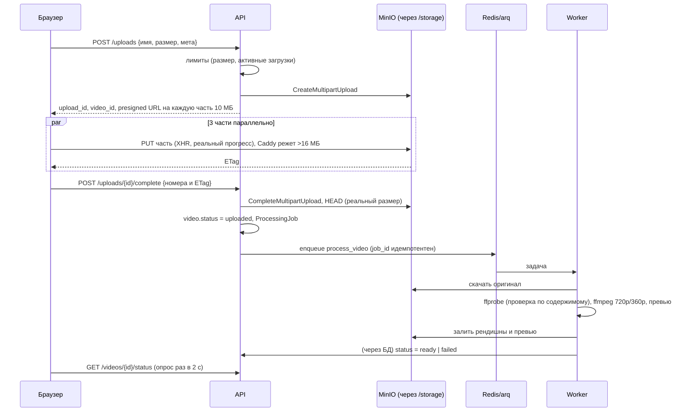
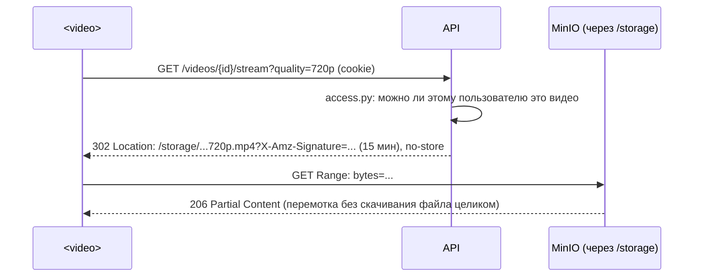

# Архитектура

Vidora — модульный монолит на FastAPI плюс отдельный процесс-воркер для обработки видео.
Всё поднимается одним `docker compose`, наружу смотрит только Caddy.

## Компоненты



| Сервис | Образ | Роль |
|---|---|---|
| `web` | `deploy/web.Dockerfile`: сборка React в Node, затем Caddy | TLS, раздача SPA, reverse proxy на API, шлюз к MinIO, заголовки безопасности |
| `api` | `backend/Dockerfile` | REST API, Swagger на `/docs` |
| `worker` | тот же образ, команда `arq` | ffprobe, транскод, превью, cron-задачи |
| `migrate` | тот же образ, разовый | `alembic upgrade head` + роль БД приложения |
| `postgres` | `postgres:16-alpine` | данные |
| `redis` | `redis:7-alpine` | очередь задач, rate limit, дедупликация просмотров |
| `minio` + `minio-init` | `bitnamilegacy/minio`, `.../minio-client` | хранилище видео, создание бакетов и пользователя приложения |

## Слои бэкенда

```
backend/app/
  api/v1/*.py        HTTP: разбор запроса, зависимости (кто пользователь, роль), коды ответа
  services/*.py      бизнес-правила: права (access.py), транзакции, счётчики, аудит
  repositories/*.py  SQL-запросы (SQLAlchemy 2, async)
  models/*.py        таблицы, ограничения, индексы
  schemas/*.py       контракты API (pydantic)
  worker/            arq-задачи и обёртки ffmpeg
  core/              конфиг, безопасность, ошибки, CSRF, Redis, очередь
```
Роутер не пишет SQL и не знает про S3. Сервис не знает про HTTP. Права на видео проверяются
в одном месте: `services/access.py`.

## Загрузка видео



Статусы: `uploading → uploaded → processing → ready | failed`. Пока пользователь заполняет
описание, видео уже грузится и обрабатывается (как на YouTube). Черновик создаётся с доступом
«Ограниченный» и публикуется кнопкой «Опубликовать».

Надёжность: часть файла перезаливается до 3 раз; задача обработки повторяется до 3 раз с
паузой, кроме случаев «это не видео»; cron раз в 5 минут переставляет в очередь видео,
зависшие в `uploaded` (например, Redis был недоступен), а раз в час прерывает брошенные
multipart-загрузки.

## Раздача (просмотр)


Python не гоняет байты видео: API только проверяет права и подписывает ссылку. MP4 собран с
`faststart`, поэтому воспроизведение начинается сразу. Если ссылка истекла, плеер снова идёт в `/stream`.

## Как подписанные ссылки работают через тот же домен

Подпись S3 включает заголовок `Host` и путь. API подписывает URL для `https://<host
из запроса>/<bucket>/<key>` и отдаёт его как `/storage/<bucket>/<key>?...`. Caddy срезает
префикс `/storage` и проксирует в MinIO, сохраняя `Host`. MinIO видит ровно то, что было
подписано. Плюсы: нет CORS, нет второго домена и второго сертификата, MinIO не торчит наружу,
всё работает по любому IP или домену, которым открыли сервер.

## ADR: ключевые решения

**ADR-1. Модульный монолит, а не микросервисы.** Одна кодовая база и одна БД, границы
модулей проведены слоями и пакетами. Для объёма задания микросервисы дали бы только
распределённые транзакции и лишнюю инфраструктуру. Тяжёлая часть (ffmpeg) всё равно вынесена
в отдельный процесс: она масштабируется отдельно (`docker compose up --scale worker=N`).

**ADR-2. arq, а не Celery.** API асинхронный, arq тоже: одна модель конкурентности, общий
async-код доступа к БД и S3. Есть всё нужное: повторы, таймауты, cron, идемпотентные job id,
healthcheck. Брокер — тот же Redis, без RabbitMQ. Celery дал бы больше возможностей
(маршрутизация, canvas), которые здесь не нужны. Минус arq: меньше сообщество и нет
веб-мониторинга (можно добавить позже).

**ADR-3. Загрузка напрямую в S3 по presigned multipart, а не стриминг через API.** Воркеры API
не держат медленные загрузки, есть реальный прогресс по частям и повтор отдельной части.
Лимит размера соблюдается тремя способами: при создании загрузки, прокси на каждую часть,
проверка собранного объекта. Цена — более сложный протокол (create/parts/complete) и обработка
брошенных загрузок (cron).

**ADR-4. Раздача 302 на короткую подписанную ссылку.** Альтернатива `X-Accel-Redirect`
(`forward_auth` в Caddy) тоже рабочая. Presigned проще, Range и кеширование делает
хранилище, а проверка прав остаётся в API. Цена: ссылка живёт 15 минут после отзыва доступа.

**ADR-5. Caddy, а не Nginx.** Автоматический HTTPS с доменом (Let's Encrypt) и внутренний CA
без домена, on-demand сертификат для любого IP (с разрешением от API), короткий конфиг. Nginx
потребовал бы certbot и отдельный скрипт для самоподписанного сертификата.

**ADR-6. React + Vite + TypeScript, сборка в Docker.** Плеер, лайки без перезагрузки,
бесконечная лента, загрузка с прогрессом — это SPA-сценарии. Node нужен только на этапе
сборки образа, на сервере его нет. Без UI-библиотек: своя небольшая дизайн-система
(`docs/design-system.md`).

**ADR-7. Cookie (httpOnly) + CSRF-токен, а не Bearer в localStorage.** XSS не может украсть
токены. Цена: CSRF-защита (double-submit + Origin). Для Swagger и API-клиентов есть Bearer.

**ADR-8. Денормализованные счётчики** в строках видео, каналов, комментариев и плейлистов вместо
`COUNT(*)` на чтении. Лента и карточки читаются чаще, чем ставятся лайки. Счётчики меняются
атомарно в той же транзакции (`docs/database.md`).

**ADR-9. MinIO из замороженного образа Bitnami.** Официальные образы MinIO ушли из Docker Hub.
Код работает с хранилищем как с обычным S3 (boto3), замена делается конфигом (`docs/NOTES.md`).

**ADR-10. Две роли в БД.** Миграции под владельцем, приложение под ролью только с DML. Если
приложение скомпрометировано, оно не может удалить таблицы или изменить схему.

## Эксплуатация

- **Деплой:** `./deploy.sh [--demo] [--domain d --email e]`, идемпотентен: секреты и данные
  сохраняются, пересобирается и перезапускается только изменённое, миграции применяются каждый раз.
- **Здоровье:** у каждого сервиса healthcheck (`/api/v1/health`, `/health/ready` с проверкой БД,
  `arq --check` у воркера). `docker compose ps` показывает статус.
- **Логи:** `docker compose logs -f api worker web`. Стектрейсы только в логах, клиенту
  уходит `{"error": {"code", "message"}}`.
- **Бэкапы (для прода):** `docker compose exec postgres pg_dump -Fc` по cron и
  `mc mirror` бакетов на внешний S3. В рамках задания не автоматизировано.
- **Масштабирование:** API и воркер stateless (`--scale worker=3`); узкие места — CPU на
  транскод и диск MinIO. Дальше: HLS с несколькими качествами, CDN перед `/storage`,
  партиционирование `video_views` по месяцам, read-реплика Postgres.
