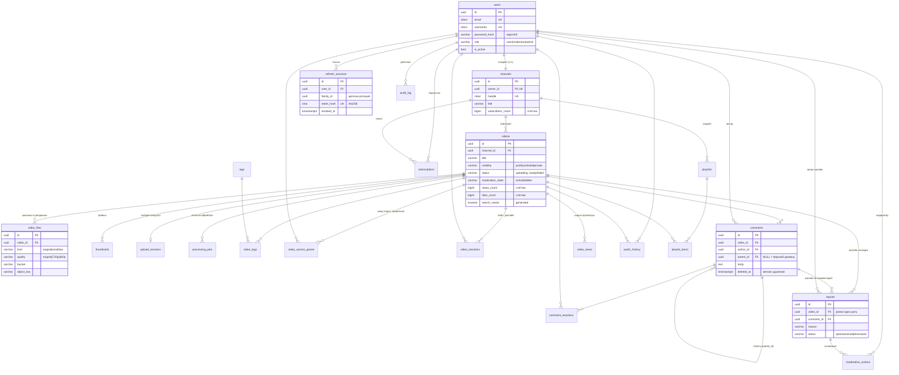

# База данных

PostgreSQL 16. Схема описана моделями SQLAlchemy 2 (`backend/app/models/`) и создаётся
миграциями Alembic (`backend/migrations/versions/`). 22 таблицы, все первичные ключи UUID
(`gen_random_uuid()`), кроме журналов (`bigserial`) и тегов.

## ER-диаграмма



## Таблицы

| Таблица | Зачем | Важные ограничения и индексы |
|---|---|---|
| `users` | аккаунты, роль, блокировка | `email`, `username` CITEXT UNIQUE (регистр не важен), CHECK формата имени |
| `channels` | публичное лицо автора, 1:1 с пользователем | `owner_id` UNIQUE, `handle` UNIQUE, CHECK `subscribers_count >= 0` |
| `refresh_sessions` | refresh-токены (только SHA-256), семьи ротации | `token_hash` UNIQUE, индексы `user_id`, `family_id` |
| `audit_log` | журнал безопасности: входы, роли, модерация, доступы | append-only, `details` JSONB, индекс по времени |
| `videos` | метаданные и состояние видео | CHECK счётчиков, частичный индекс ленты, GIN по `search_vector`, GIN trgm по `title` |
| `video_files` | объекты в S3: оригинал и рендишны | UNIQUE (`video_id`, `quality`), UNIQUE (`bucket`, `object_key`) |
| `thumbnails` | превью | частичный UNIQUE: не больше одного `is_primary` на видео |
| `upload_sessions` | незавершённые multipart-загрузки | частичный индекс `pending` по `expires_at` (для очистки) |
| `processing_jobs` | история попыток обработки | индекс `video_id` |
| `tags`, `video_tags` | теги (M:N) | `tags.name` CITEXT UNIQUE, PK (`video_id`, `tag_id`) |
| `video_access_grants` | кому владелец открыл приватное видео | PK (`video_id`, `user_id`) |
| `subscriptions` | подписки | PK (`subscriber_id`, `channel_id`), индекс по каналу |
| `video_reactions` | лайк/дизлайк | PK (`user_id`, `video_id`): одна реакция на человека, CHECK `value IN (-1,1)` |
| `comments` | комментарии с одним уровнем ответов | CHECK длины, частичные индексы для верхнего уровня и для ответов |
| `comment_reactions` | лайки комментариев | PK (`user_id`, `comment_id`) |
| `video_views` | сырые события просмотров (для аналитики) | индекс (`video_id`, `created_at`); кандидат на партиционирование по месяцам |
| `watch_history` | «История» | PK (`user_id`, `video_id`), индекс по времени просмотра |
| `playlists`, `playlist_items` | плейлисты | UNIQUE (`playlist_id`, `video_id`), индекс по позиции |
| `reports` | жалобы | CHECK `num_nonnulls(video_id, comment_id) = 1`; частичный UNIQUE: одна открытая жалоба от человека на видео; частичный индекс очереди `open` |
| `moderation_actions` | решения модераторов: кто, что, почему | никогда не удаляются, FK `ON DELETE SET NULL` |

## Решения и почему так

- **UUID, а не автоинкремент.** Id видео светится в URL: по UUID нельзя перебрать чужие объекты
  и оценить объём сервиса. `gen_random_uuid()` встроен в PG 13+.
- **Перечисления как VARCHAR + CHECK, а не нативный ENUM.** Добавить значение в CHECK проще,
  чем `ALTER TYPE ... ADD VALUE` (который нельзя откатить в транзакции).
- **CITEXT** для email, логина, handle и тегов: уникальность без учёта регистра на обычном
  UNIQUE-индексе, без `lower()` в каждом запросе.
- **Денормализованные счётчики** (`views_count`, `likes_count`, `comments_count`,
  `subscribers_count`, `items_count`). Лента не делает `COUNT(*)` по реакциям. Счётчик меняется
  в той же транзакции, что и исходная строка, атомарным `UPDATE ... SET x = x + d RETURNING`.
  Повторный клик не задваивает счётчик: дельта считается только если строка реально
  вставлена или удалена (`ON CONFLICT DO NOTHING RETURNING`), а реакции дополнительно
  сериализуются advisory-lock'ом на пару (пользователь, видео). Есть тест на параллельные клики.
- **Частичные индексы** под реальные запросы: лента (`status='ready' AND visibility='public'
  AND moderation_state='active'`), очередь жалоб (`status='open'`), скрытые видео,
  незавершённые загрузки. Индекс маленький и попадает ровно в выборку.
- **Поиск.** Сгенерированный столбец `search_vector` (`to_tsvector('russian')`, вес A у названия
  и B у описания) с GIN-индексом даёт поиск по формам слов («кошка» находит «кошки»). Для опечаток
  используется `pg_trgm` (`word_similarity`, оператор `<%`) с GIN trgm-индексом по `title`.
- **Каскады.** Удаление видео каскадно удаляет файлы, превью, реакции, комментарии и т.п.
  (`ON DELETE CASCADE`). Журналы (`audit_log`, `moderation_actions`, `reports.reporter_id`)
  ссылаются через `SET NULL`: история модерации переживает удаление объектов.
- **Комментарии с ответами.** Один уровень вложенности, как на YouTube: ответ на ответ
  прикрепляется к корню ветки. Если у удаляемого комментария есть ответы, он удаляется мягко
  (`deleted_at`, текст стирается), чтобы ветка не развалилась.
- **Просмотры.** Дедупликация (один просмотр на зрителя за 30 минут) делается в Redis
  (`SET NX EX`), в БД пишется только засчитанный просмотр. Вместо IP хранится хэш (`viewer_hash`).

## Что где хранится

| Данные | Где |
|---|---|
| Метаданные, пользователи, связи, журналы | PostgreSQL |
| Видео (оригинал и 720p/360p), превью | MinIO (S3), приватные бакеты `vidora-raw` и `vidora-media` |
| Очередь фоновых задач, rate limit, дедупликация просмотров | Redis |
| Секреты | `.env` на сервере (генерирует `scripts/gen_env.sh`), не в git |

Ключи объектов строятся только из UUID (`uploads/<video_id>/original`,
`videos/<video_id>/720p.mp4`): пользовательский ввод в путь не попадает.

## Миграции

```bash
docker compose run --rm migrate                      # применить (делается при каждом deploy)
docker compose run --rm migrate alembic downgrade -1 # откатить последнюю
```

Миграция `0001` сгенерирована `alembic revision --autogenerate`, затем проверена вручную:
autogenerate не создаёт расширения, поэтому `CREATE EXTENSION citext / pg_trgm` дописаны руками.
Проверено: `upgrade head -> downgrade base -> upgrade head`, затем `alembic check` (модели и
схема совпадают).
